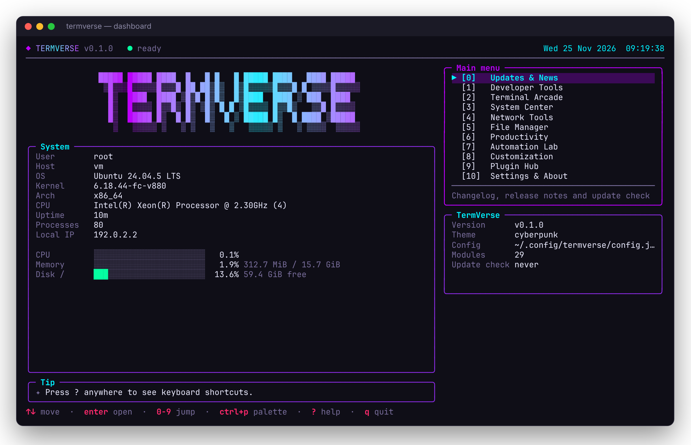
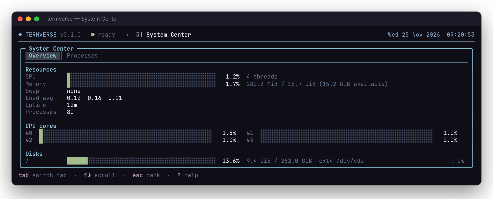
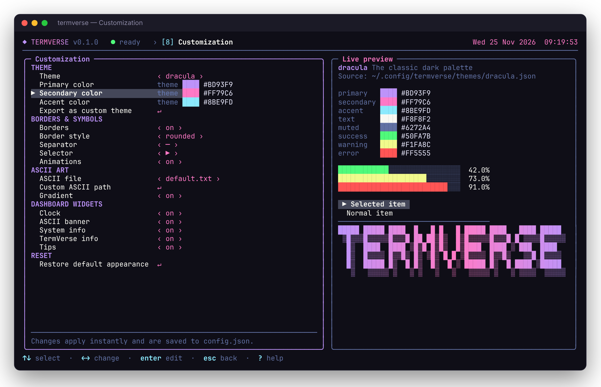
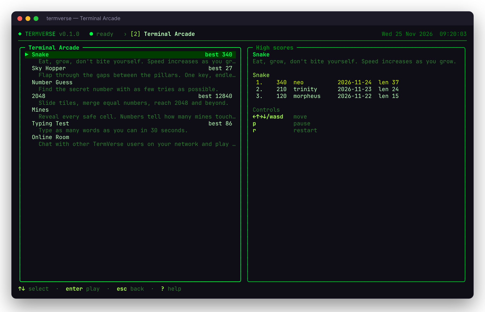
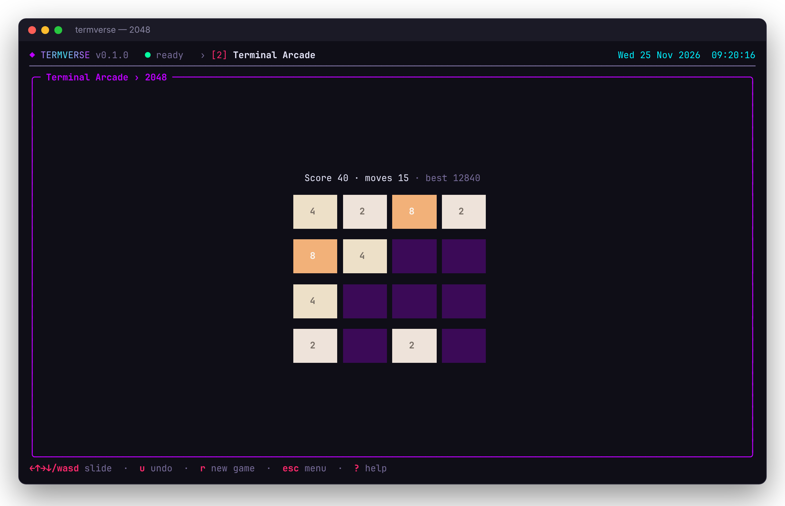
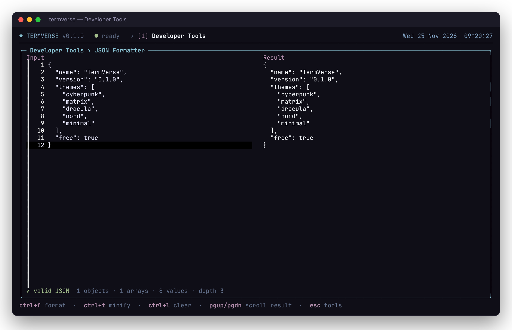
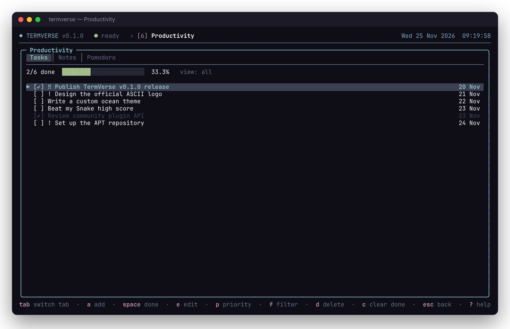
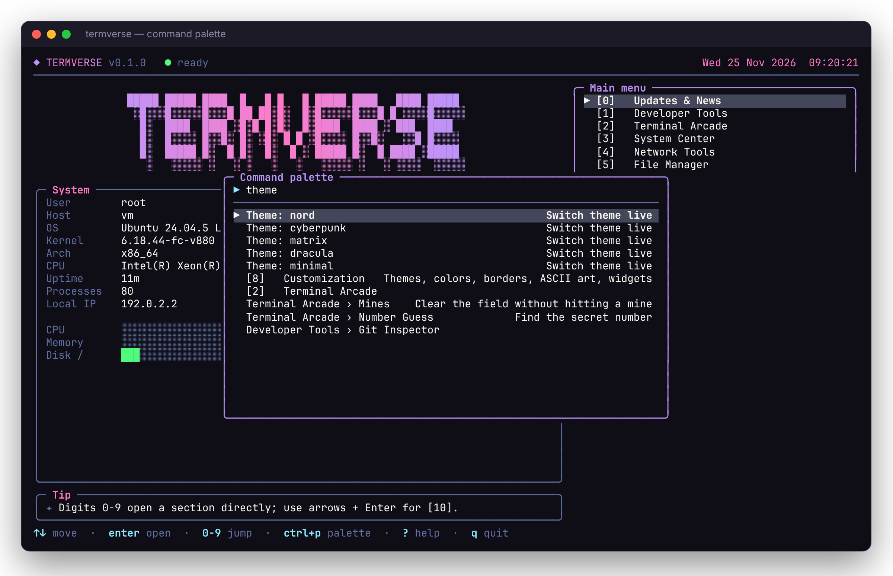
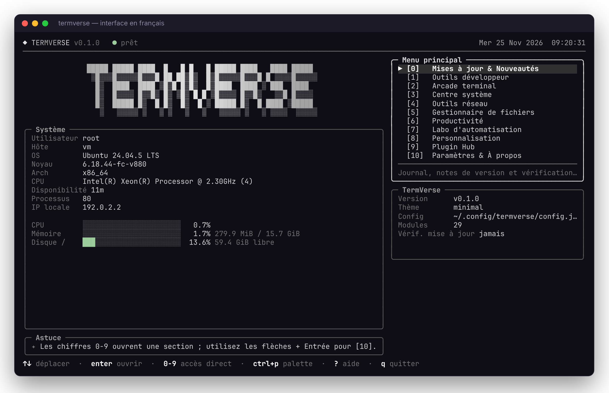

<div align="center">

# TermVerse

**A modern, fully customizable terminal environment — dashboard, dev tools, arcade, system & network utilities, productivity and automation in one fast binary.**

[](https://github.com/KAYTAY10ok/TermVerse/actions/workflows/ci.yml)
[](https://github.com/KAYTAY10ok/TermVerse/releases/latest)
[](https://github.com/KAYTAY10ok/TermVerse/releases)
[](go.mod)
[](#installation)
[](LICENSE)
[](#language)

`tui` · `terminal` · `dashboard` · `go` · `bubbletea` · `linux` · `system-monitor` · `developer-tools` · `terminal-games` · `themes`



</div>

---

## Table of contents

- [Features](#features)
- [Screenshots](#screenshots)
- [Installation](#installation)
- [Usage](#usage)
- [Configuration & themes](#configuration--themes)
- [Online Room](#online-room)
- [Building from source](#building-from-source)
- [Architecture](#architecture)
- [Releasing](#releasing)
- [Roadmap](#roadmap)
- [Contributing](#contributing)
- [License](#license)

## Features

| # | Section | What you get |
|---|---------|--------------|
| 0 | **Updates & News** | What's new, full changelog, manual GitHub release check (10 s timeout). Never installs anything on its own. |
| 1 | **Developer Tools** | Git inspector · JSON formatter/validator with line:column errors · UUID v4/v7 · Base64 · MD5/SHA-1/SHA-256/SHA-512/CRC32 of text or files · timestamp converter · secure password generator · regex tester · HTTP GET/HEAD client · listening ports |
| 2 | **Terminal Arcade** | Snake · Sky Hopper · Number Guess · 2048 · Mines · Typing Test · **Online Room** (chat + two-player Four in a Row over LAN/Internet) · persistent high scores |
| 3 | **System Center** | Live CPU (total and per core), memory, swap, load, uptime, disks, temperature sensors, hardware info, and a **process manager** (sort, filter, SIGTERM/SIGKILL after confirmation) |
| 4 | **Network Tools** | Interfaces with addresses and traffic · DNS lookup (A/AAAA/CNAME/MX/NS/TXT/PTR) · TCP connection test with latency · socket statistics |
| 5 | **File Manager** | Read-only browser · sizes, permissions, owner, metadata · text preview with line numbers · hex dump for binaries · filter, sort, hidden files |
| 6 | **Productivity** | Tasks with priorities and filters · multi-line quick notes · Pomodoro timer with statistics — all saved locally |
| 7 | **Automation Lab** | Saved command shortcuts · every run shows the exact command and asks for confirmation · stdout/stderr, exit code, duration, timeout, cancel |
| 8 | **Customization** | Live theme switching · primary/secondary/accent colors · borders and border style · separators · selector · ASCII art · gradient · animations · dashboard widgets · export your palette as a theme · restore defaults |
| 9 | **Plugin Hub** | Built-in modules with version and description · enable/disable optional modules · local plugin manifest discovery (never executed) |
| 10 | **Settings & About** | Language, theme, refresh interval, vim keys, mouse, quit confirmation, timers, update check, reset, paths, license |

And everywhere: **command palette** (`Ctrl+P`, fuzzy search over every screen, tool, theme and action), help overlay (`?`), responsive layout down to 40×12, **English and French** interface, real system data only (`N/A` when something cannot be read).

## Screenshots

<table>
<tr>
<td width="50%"><br><sub><b>System Center</b> — Nord theme</sub></td>
<td width="50%"><br><sub><b>Customization</b> with live preview — Dracula theme</sub></td>
</tr>
<tr>
<td><br><sub><b>Terminal Arcade</b> and high scores — Matrix theme</sub></td>
<td><br><sub><b>2048</b> in the arcade — Cyberpunk theme</sub></td>
</tr>
<tr>
<td><br><sub><b>Developer Tools › JSON Formatter</b> — Nord theme</sub></td>
<td><br><sub><b>Productivity</b> tasks — Nord theme</sub></td>
</tr>
<tr>
<td><br><sub><b>Command palette</b> (<code>Ctrl+P</code>) — Dracula theme</sub></td>
<td><br><sub><b>Interface en français</b> — Minimal theme</sub></td>
</tr>
</table>

## Installation

> Supported: Linux on **amd64** (x86_64) and **arm64** (aarch64). Release binaries are static: no dependencies.

### 1. One-line installer (recommended)

```bash
curl -fsSL https://raw.githubusercontent.com/KAYTAY10ok/TermVerse/main/scripts/install.sh | bash
```

The script detects your architecture, downloads the latest release, **verifies its SHA-256 checksum** and installs `termverse` into `~/.local/bin` — no `sudo` required.

Install a specific version or into another directory:

```bash
curl -fsSL https://raw.githubusercontent.com/KAYTAY10ok/TermVerse/main/scripts/install.sh | TERMVERSE_VERSION=0.1.0 TERMVERSE_BIN_DIR="$HOME/bin" bash
```

### 2. Debian / Ubuntu package (.deb)

```bash
wget https://github.com/KAYTAY10ok/TermVerse/releases/download/v0.1.0/termverse_0.1.0_amd64.deb
sudo apt install ./termverse_0.1.0_amd64.deb
```

On ARM (Raspberry Pi 4/5 64-bit, ARM servers) use `termverse_0.1.0_arm64.deb`. Remove it with `sudo apt remove termverse`.

> **APT repository:** `sudo apt install termverse` from a repository is **not available yet** — it is on the roadmap (signed repository published from the release workflow). Use the `.deb` above in the meantime.

### 3. Manual download with checksum verification

```bash
VERSION=0.1.0
ARCH=amd64   # or arm64
wget https://github.com/KAYTAY10ok/TermVerse/releases/download/v${VERSION}/termverse_${VERSION}_linux_${ARCH}.tar.gz
wget https://github.com/KAYTAY10ok/TermVerse/releases/download/v${VERSION}/checksums.txt
sha256sum --ignore-missing -c checksums.txt
tar -xzf termverse_${VERSION}_linux_${ARCH}.tar.gz termverse
install -Dm755 termverse ~/.local/bin/termverse
```

### 4. With Go

```bash
go install github.com/KAYTAY10ok/TermVerse/cmd/termverse@latest
```

### Uninstall

```bash
rm ~/.local/bin/termverse              # binary installed by the script
rm -r ~/.config/termverse ~/.local/share/termverse   # optional: settings and data
```

## Usage

```bash
termverse                      # start the interactive interface
termverse --help               # help
termverse --version            # version, commit and build date
termverse config path          # where configuration and data live
termverse config reset         # reset config.json (asks first; --yes to skip)
termverse theme list           # available themes (* = active)
termverse theme set matrix     # select a theme
termverse system               # system summary, scriptable
```

### Keyboard

| Key | Action |
|-----|--------|
| `↑` `↓` (or `j` `k`) | Move |
| `Enter` | Open / confirm |
| `0` – `9` | Open a section directly from the dashboard (`[10]`: arrows + Enter) |
| `Esc` | Back |
| `Ctrl+P` | Command palette |
| `?` | Shortcuts of the current screen |
| `q` | Quit from the dashboard — `Ctrl+C` quits anywhere |

### Language

The interface follows `$LANG` (`fr_*` → French, anything else → English). Change it in **Settings [10]** or with the palette (`Ctrl+P` → *Language*).

## Configuration & themes

TermVerse follows the XDG Base Directory specification (`$XDG_CONFIG_HOME`, `$XDG_DATA_HOME`). Everything is created on first launch, and existing files are never overwritten.

```
~/.config/termverse/
├── config.json         preferences (written atomically)
├── themes/             cyberpunk · matrix · dracula · nord · minimal · your own
├── ascii/default.txt   dashboard ASCII art
└── plugins/            local plugin manifests (listed, never executed)

~/.local/share/termverse/
├── tasks.json   notes.json   pomodoro.json
└── scores.json  automation.json  state.json
```

If a JSON file is invalid, it is kept as `<name>.invalid-<date>` and defaults are used: nothing is lost.

### Built-in themes

| Theme | Palette |
|-------|---------|
| `cyberpunk` | neon violet and electric cyan (default) |
| `matrix` | phosphor green on black |
| `dracula` | the classic dark palette |
| `nord` | arctic, cold blues |
| `minimal` | sober greys |

### Create your own theme

Save `~/.config/termverse/themes/ocean.json` (missing colors fall back to the default theme):

```json
{
  "name": "ocean",
  "description": "Deep blue",
  "colors": {
    "primary": "#0077BE", "secondary": "#00B4D8", "accent": "#FFB703",
    "text": "#E0F7FA", "muted": "#5C7C8A", "border": "#0096C7",
    "highlight": "#023E58", "highlight_text": "#FFFFFF",
    "success": "#06D6A0", "warning": "#FFD166", "error": "#EF476F"
  }
}
```

Then run `termverse theme set ocean`, or pick it in **Customization [8]**. You can also tweak colors live and use *Export as custom theme*.

### Custom ASCII art

Put any text file in `~/.config/termverse/ascii/` and select it in **Customization → ASCII file**, or give an absolute path with *Custom ASCII path*.

## Online Room

**Arcade [2] → Online Room**

- **Host a room**: opens a TCP port (default `7777`) only when you choose it, shows the addresses your friends can use, and lets you set a password.
- **Join a room**: enter `host-ip:7777` and the password.
- Chat with everyone in the room; two players take a seat (`tab`, then `j`) and play **Four in a Row**, with a running score.

Over the Internet, the host must forward the port on their router. Limits: 8 players, 4 KiB messages, rate limiting, control characters stripped. Traffic is **not encrypted**, so do not share secrets in the chat.

## Building from source

Requires **Go 1.24+**.

```bash
git clone https://github.com/KAYTAY10ok/TermVerse.git
cd TermVerse
go mod download
go build -o termverse ./cmd/termverse
./termverse
```

Makefile targets:

| Command | Description |
|---------|-------------|
| `make build` | Build `./termverse` with version information |
| `make run` | Build and start |
| `make test` | Run all tests |
| `make lint` | `go vet` + formatting check |
| `make install` | Install to `~/.local/bin` (override with `PREFIX=`) |
| `make deb` | Build `termverse_<version>_<arch>.deb` |
| `make clean` | Remove build outputs |

## Architecture

```
cmd/termverse/        entry point: CLI dispatch → TUI
embed.go              embedded changelog, themes and ASCII art
internal/
  app/                root Bubble Tea model, navigation, palette, overlays
  dashboard/          home screen layout
  ui/                 shared context, styles, widgets, lists, forms, i18n
  config/             XDG paths, config schema, validation, bootstrap
  theme/              theme parsing, validation, registry
  system/             real system metrics and processes (gopsutil)
  netinfo/            network diagnostics
  update/             GitHub release check, semver comparison
  registry/           module registry, plugin manifests, future plugin API
  cli/                non-interactive commands
  fsutil/             atomic writes, safe JSON helpers
modules/              one package per section: updates, devtools, arcade (+ online),
                      systemcenter, network, filemanager, productivity,
                      automation, customization, plugins, settings
scripts/install.sh    release installer with SHA-256 verification
packaging/deb/        .deb builder
.github/workflows/    CI (format, vet, race tests, builds, shellcheck, .deb) and releases
```

Built with [Bubble Tea](https://github.com/charmbracelet/bubbletea), [Lip Gloss](https://github.com/charmbracelet/lipgloss), [Bubbles](https://github.com/charmbracelet/bubbles) and [gopsutil](https://github.com/shirou/gopsutil).

## Releasing

```bash
git tag v0.1.1
git push origin v0.1.1
```

The **Release** workflow runs the tests, then GoReleaser publishes:

- `termverse_<version>_linux_amd64.tar.gz` and `termverse_<version>_linux_arm64.tar.gz`
- `termverse_<version>_amd64.deb` and `termverse_<version>_arm64.deb`
- `checksums.txt` (SHA-256)
- release notes taken from `CHANGELOG.md`

## Roadmap

- [ ] Signed APT repository (`sudo apt install termverse`)
- [ ] Community plugins (out-of-process, JSON-RPC, explicit permissions)
- [ ] Docker panel and API collections in Developer Tools
- [ ] More arcade games; encrypted (TLS) Online Room
- [ ] Optional file operations in the File Manager (always confirmed)
- [ ] Official ASCII logo
- [ ] macOS builds

## Contributing

1. Fork the repository and create a branch.
2. Make sure `make lint test` passes.
3. Wrap new UI strings in `ui.T()` and add the French translation to `internal/ui/i18n_fr.go` (the `TestFrenchCoverage` test checks it).
4. Open a pull request describing your change.

## License

[MIT](LICENSE) © 2026 TermVerse contributors
